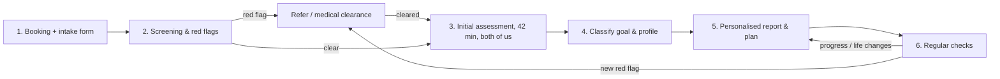
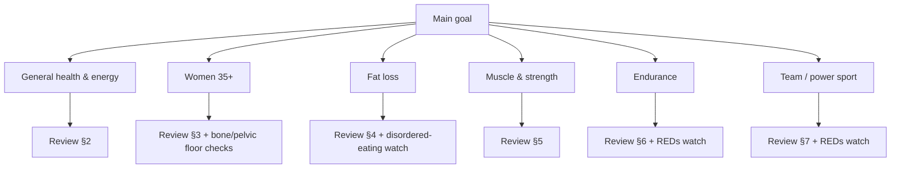

# BGB Health — Personalised client workflow

*Internal working document. Version 1, November 2026.*
*Companion to `01_guidelines_review.md` (the evidence) — this file is the process.*

---

## Overview

| Step | Who | When | Output |
|---|---|---|---|
| 1. Intake | client (online form) | after booking, ≥48 h before session | intake answers in Supabase |
| 2. Screening | Basílio + Gwen | before the session | go / refer / clearance needed |
| 3. Initial assessment | both | 42 min video call | measurements + goals agreed |
| 4. Classification | both | same day | goal profile + priorities |
| 5. Report & plan | Basílio (training), Gwen (nutrition) | told to client in step 3 (1 day – 1 week) | PDF report + plan |
| 6. Regular checks | lead coach | every 2–4 weeks | adjusted plan, progress log |

---

## Step 1 — Booking and intake form

Sent automatically after booking (to build). Keep it short (≤10 min) and explain why we ask.

**About you:** age, sex, height, body mass, occupation and typical weekday (sitting / standing / active), sleep (hours, quality), stress (1–10).

**Goals:** main goal (pick one): *general health & energy · fat loss · muscle & strength · endurance performance · team/power sport · women 35+ programme*, plus their own words: "In 6 months I want to…". Event or deadline? What has worked or failed before?

**Training:** current weekly routine (type, minutes, intensity), training age, available equipment, days and time windows, sports history, preferences and dislikes.

**Nutrition:** usual meals and timing, diet pattern (omnivore, vegetarian, vegan), foods avoided and why, alcohol, caffeine, supplements, cooking time and budget.

**Health screening (PAR-Q+ style):** see step 2. Women: menstrual cycle regular? perimenopause/menopause symptoms? pregnancy or recent birth? pelvic-floor symptoms?

**Consent:** GDPR consent for health data, statement that we advise healthy adults and don't treat medical conditions, permission to contact their doctor if needed.

> Data: health answers are special-category data under GDPR. Store them only in the locked Supabase project (EU region), never in email or WhatsApp. Delete on request.

---

## Step 2 — Screening and red flags (before the session)

1. Go through the **PAR-Q+**-style answers and the red-flag table in `01_guidelines_review.md`, section 9.
2. Decide:
   - **Green** — no flags → book the assessment as normal.
   - **Amber** — known condition that is stable, or a question we can't answer → ask for **medical clearance** before training changes; nutrition limited to general healthy-eating guidance.
   - **Red** — signs of heart symptoms, disordered eating, REDs, acute injury, pregnancy without clearance, mental-health crisis → **do not coach**; explain kindly, refer (GP, Diätolog:in, physio, sports physician), offer to start once cleared. Record the referral.
3. Note any **adaptations** for the assessment (e.g. no jump tests with osteoporosis, no max tests for beginners).

---

## Step 3 — Initial assessment (42 min, both of us)

| Min | Part | Lead | Content |
|---|---|---|---|
| 0–5 | Welcome | both | introductions, confirm consent, agenda |
| 5–15 | Goals & context | both | motivational interview: why now, barriers, time available, what success looks like; agree **1 main goal + max 2 secondary** |
| 15–27 | Physical assessment | Basílio | movement screen on video (squat, lunge, hinge, push-up, single-leg balance); strength/power tests suited to level; running or sport video if relevant (or homework via BioScout) |
| 27–37 | Nutrition assessment | Gwen | 24-h recall, meal timing, protein and fibre estimate, hydration, supplements; agree 3-day food diary as homework |
| 37–42 | Next steps | both | what the report will contain, **when they get it** (1 day – 1 week, depending on homework), first small habit to start now |

**Test menu (choose per client, keep it safe and repeatable):**

| Area | Beginner / 35+ | Trained / athlete |
|---|---|---|
| Lower-body strength | 30-s sit-to-stand | estimated 3–5RM squat/deadlift from training log |
| Upper-body | push-ups (knees or full) | push-ups to fatigue, pull-ups |
| Power | — / countermovement jump if no contraindication | countermovement jump (BioScout video) |
| Balance | single-leg stance, eyes open/closed | Y-balance style reach |
| Aerobic | talk test / 6-min walk | recent race or time-trial result, HR zones |
| Body | waist circumference, body mass | + skinfolds or photos if wanted |
| Movement | squat, hinge, lunge video | sport-specific / running video |

---

## Step 4 — Classify the client (decision tree)

Then set the **modifiers** that personalise the plan:

| Modifier | Question | Effect on the plan |
|---|---|---|
| Time | how many sessions × minutes really fit? | choose the minimum effective dose first; add later |
| Training age | <6 months / 6–24 / >2 years | load, volume, complexity |
| Life stage | perimenopause, postmenopause, ≥65 | bone, power, protein per meal, pelvic floor |
| Energy | deficit, maintenance, surplus | protein target, REDs and wellbeing checks |
| Preferences | food culture, vegetarian/vegan, budget, equipment | meal plan built from foods they already eat |
| Barriers | shift work, travel, children, motivation | habit design, fallback "minimum sessions" |
| Data | wearable, BioScout, food app | what we track and how often |

---

## Step 5 — Personalised report and plan

Delivered as one combined document (PDF or shared page). Every number must trace back to the review or to the client's own data.

**Report outline**
1. **Your goal in one sentence** and the 3 numbers we will track.
2. **Where you are now:** assessment results shown against **reference values** (age/sex norms from the literature or our database), traffic-light style.
3. **Training plan** (Basílio): weekly schedule, exercises with videos, sets/reps/effort, progression rule, the "minimum week" for busy weeks.
4. **Nutrition plan** (Gwen): daily targets (protein, fibre, fluids; carbohydrate for athletes), plate model, example day built from their foods, shopping list, 3 swaps.
5. **Habits:** max 3 at a time (e.g. protein at breakfast, 8,000 steps, lights out by 23:00).
6. **Next check date** and how to reach us.

**Default targets by profile** (starting points — see review for details)

| Profile | Training (per week) | Protein | Other nutrition focus |
|---|---|---|---|
| General health | 2× strength, 150 min moderate cardio / steps | 1.2–1.6 g/kg | Austrian plate, afternoon snack, caffeine timing |
| Women 35+ | 2–3× progressive strength + impact (if safe), balance, pelvic floor, 150 min cardio | 1.2–1.6 g/kg, ≥25–30 g/meal | calcium ~1,000 mg, fibre/legumes, vitamin D via GP, creatine optional |
| Fat loss | 2–3× strength, steps ↑, 150–250+ min activity | 1.6–2.2 g/kg | −0.5–1 % body mass/week, high fibre, maintenance plan |
| Muscle & strength | 3–4× strength, 10–20 sets/muscle | 1.6 (1.4–2.2) g/kg | small surplus, creatine 3–5 g |
| Endurance | polarised volume + 2× strength | 1.2–2.0 g/kg | carbs 3–12 g/kg by load, 30–90 g/h in sessions, caffeine optional |
| Team / power | periodised strength/power/speed | 1.6–2.0 g/kg | carbs 5–8 g/kg, match-day plan |

---

## Step 6 — Regular checks

| When | Format | What we review | Decision |
|---|---|---|---|
| Week 1 | short message | did the plan start? any problems? | quick fixes |
| Every 2–4 weeks | 15–20 min call | training log, food diary snapshot, the 3 tracked numbers, sleep/stress, wellbeing | adjust load, targets, habits |
| Every 12 weeks | re-assessment (same tests) | progress vs baseline and reference values | new block, new goal or graduate to maintenance |

**Adjustment rules**
- **Progressing** → progress load/volume by small steps; keep nutrition.
- **Stalled ≥3 weeks** → check adherence first (what really happened?), then sleep/stress, then change one variable at a time.
- **Too hard / not doing it** → cut to the "minimum week"; make the plan smaller, not the goal.
- **New pain, injury, or any red flag** → stop the affected part and refer (step 2).
- **Fat-loss clients:** after 8–12 weeks of deficit, plan a maintenance phase.

**Our internal log per client:** goal, profile, modifiers, tests with dates, plan versions, referrals, notes. Keep it in Supabase (to build), not in personal notes.

---

## To build next (tech)
- Intake form linked to the booking page, stored in Supabase with admin-only access.
- Client record + test results in Supabase; report generated from it.
- Reference-value tables per test (age/sex) for the "compare with reference values" part of the report.
- Re-assessment reminders (push notification to us, email to client).
